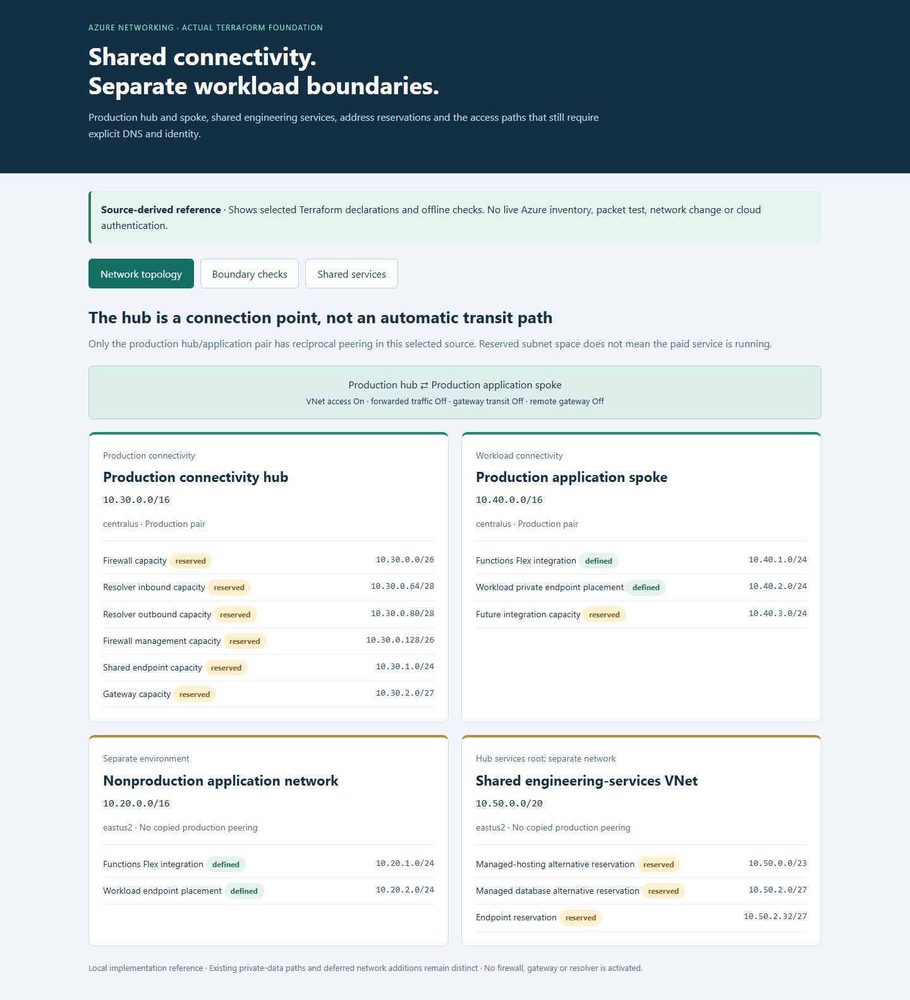
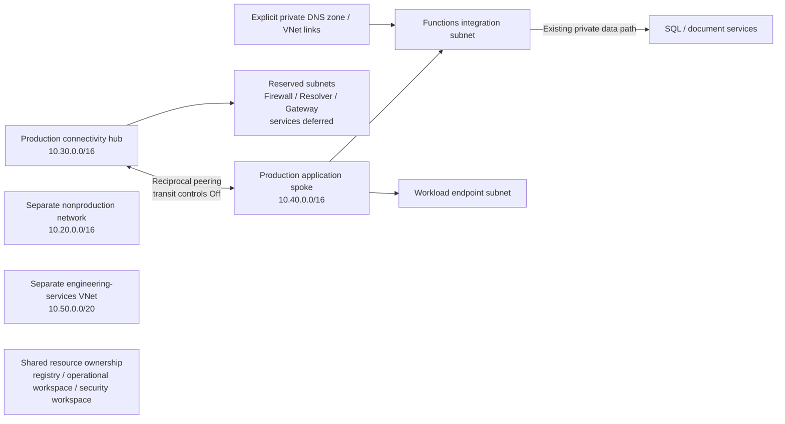
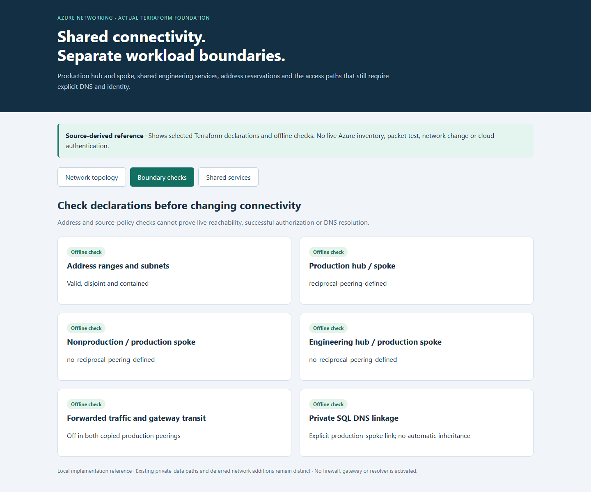

# Azure Hub-and-Spoke Networking and Shared Services

**Separate application networks while keeping shared connections organized.**

[Business problem](#the-business-problem) · [Solution](#the-solution) · [What was built](#what-was-built) · [Proof it works](#proof-it-works) · [Commands](docs/COMMANDS.md) · [Step by step](#step-by-step)



## The Business Problem

Production, testing and shared engineering services need clear network boundaries. Adding connections without a plan can create overlapping address ranges or unexpected access. The design also needed room to grow without immediately paying for a firewall, gateway or DNS Resolver service.

## The Solution

Use a central network, called a hub, and a separate application network, called a spoke. Define the connections and address ranges explicitly, reserve space for future services, and keep shared engineering services separately owned. Network connections, name lookup and data permissions are checked separately.

**Business outcome:** Provide an organized network foundation that can grow without assuming every connected system can access every other system.

### Actual implementation

- Production hub: **10.30.0.0/16**, peered in both directions with the production application spoke, **10.40.0.0/16**.
- Production integration subnet: **10.40.1.0/24**; endpoint subnet: **10.40.2.0/24**; future integration reservation: **10.40.3.0/24**.
- Separate nonproduction application network: **10.20.0.0/16**, using the reusable module.
- Separate shared engineering-services VNet: **10.50.0.0/20**, owned by a different infrastructure root. The selected source does not define a production peering for this VNet.
- Both production peerings allow VNet access and keep forwarded traffic, gateway transit and remote-gateway use **Off**.
- Firewall, resolver and gateway subnet reservations do **not** create those services.

The project includes actual selected Terraform with example resource names, plus a small new offline topology viewer and address-policy checks. This is evidence based on the source code, not a fresh Azure inventory or live packet test. [Source mapping](docs/SOURCE-MAP.md).

## Tools Used and What They Do

| Tool or service | What it does | Where it fits |
| --- | --- | --- |
| Terraform | Describe shared network placement and caller paths and the selected resource relationships. | Actual source patterns plus default-Off public examples. |
| Azure Virtual Network, peering and NSGs | Connect and filter the intended network paths. | Azure network components, not application authorization. |
| Private endpoints and Azure Private DNS | Provide selected private service addresses and name resolution. | Architecture/reference components; existence and current activation require separate evidence. |
| Azure CLI, PowerShell and DNS lookup utilities | Inspect resource state and check resolution from the intended caller. | Operating tools; a laptop result does not prove a hosted caller’s path. |
| Microsoft Entra ID and service data roles | Authorize access after the network path is available. | Separate identity layer; a reachable private IP grants no data permission. |
| Python and Terraform mock tests | Run the public decision model and infrastructure checks. | Local validation, not a packet test or cloud deployment. |

The recorded nonproduction endpoint cost pause means private paths must be restored before the affected tests resume. These examples do not recreate them, and the manual-only workflow does not activate paid networking.

## Step by Step

A short walkthrough of the process, with technical instructions and evidence limits in the sections below.

1. **Assign a purpose to each network** — Use a central hub for selected shared connectivity and separate networks for application workloads. Give each network a clearly owned address range.

2. **Define the intended connections (Terraform)** — Describe the approved links and service areas in reusable setup code. Reserved space for a future service does not mean that service is deployed.

3. **Check the full access path (Private DNS, routes and roles)** — Review routing, name lookup and identity permissions separately. Connecting two networks does not automatically grant access to every service.

4. **Validate before expanding** — The local checks test example address plans and proposed setup settings. A real expansion still needs caller checks, cost review and an agreed operating owner.

## Architecture



The isolated boxes are deliberate: the selected source does not prove a route from every network to every other network. Shared workspaces and registry ownership do not place those managed services inside a hub subnet. [Architecture detail](docs/ARCHITECTURE.md).

## What Was Built

| Component | Purpose | Source |
| --- | --- | --- |
| Reusable network module | Resource group, VNet, delegated Functions integration and endpoint subnet | [Module](infra/modules/network/) |
| Production hub and spoke | Actual address plan, reservations and peering configured in both directions | [Hub](infra/modules/foundation/hub.tf) · [Spoke](infra/modules/foundation/network.tf) |
| Default-Off public wrapper | Make local validation reproducible without selecting cloud resources by default | [Root](infra/main.tf) |
| Nonproduction network reference | Show environment-specific inputs to the same module | [Source](reference/nonproduction/network.tf) |
| Shared engineering VNet reference | Show separate network ownership and reserved managed-service subnets | [Source](reference/shared-services/network.tf) |
| Shared monitoring boundaries | Keep operational and security workspaces/ingestion distinct | [References](reference/monitoring/) |
| Existing private data/DNS reference | Explain SQL and document endpoint placement and explicit DNS links | [References](reference/dns/) |
| Offline topology checks | Reject overlapping/escaped address plans and avoid inferred peering/transit | [Model](lab/topology.py) |

The `reference/` files are source excerpts with unresolved owning-root inputs; they are not an extra independently deployable stack. The executable Terraform root creates only the selected network foundation if deliberately enabled, and does not deploy database, registry, monitoring, Firewall, resolver or gateway services.

## Proof It Works

### 1. Validate the address plan

```bash
python -B -m unittest discover -s tests -v
python -B -m lab.topology
```

**Look for:** valid disjoint networks, contained non-overlapping subnets, refusal of duplicate/unknown peerings and explicit separation of the engineering VNet. Tests compare modeled prefixes and transit settings with the copied source.

### 2. Do not assume hub transit or DNS inheritance

The model checks that reciprocal production peering is defined. A fictional second spoke peered with the hub does not become directly peered with the first spoke. The SQL DNS reference links the client VNet explicitly; peering does not copy the link to the hub.



These declaration checks are not a route-engine simulation. They do not evaluate NSGs, effective routes, service firewalls, endpoint state or application authorization. [Routing and access](docs/ROUTING-AND-DNS.md).

### 3. Validate Terraform without deploying it

```bash
terraform -chdir=infra init -backend=false -input=false
terraform -chdir=infra fmt -check -recursive
terraform -chdir=infra validate
terraform -chdir=infra test
```

**Look for:** three cases using simulated responses verify default-Off selection, the actual address/reservation plan and both peerings' access/transit flags. No Azure plan/apply or resource lookup occurs.

### 4. Inspect the local topology

```bash
python -B scripts/preview.py
```

Open [the local reference viewer](http://127.0.0.1:8137). Switch between Network topology, Boundary checks and Shared services. The browser screenshots show this local reference, not Azure Portal. Ctrl+C stops it. [Dated validation](docs/VALIDATION.md).

## Where Shared Services Belong

| Service | Suitable ownership/placement | What to avoid assuming |
| --- | --- | --- |
| Transit, gateway, resolver | Connectivity ownership; dedicated reserved subnets when actually commissioned | An empty named subnet is an active service |
| Backstage/engineering tooling | Dedicated service boundary, possibly a services VNet/subscription | Every tool belongs in the transit hub |
| Operational workspace | Shared operational resource group and reader/ingestion controls | A Log Analytics workspace is a VM in the hub VNet |
| Security workspace | Separate security access, retention and selected ingestion | All application logs should automatically enter Sentinel |
| Registry | Shared platform ownership, scoped build/pull identities | Hub placement makes a public registry endpoint private |
| SQL and employee documents | Workload-owned data and authorization boundaries | Shared connectivity implies shared data permissions |

The implemented source has multiple infrastructure roots and network meanings of “hub.” A separate services VNet/subscription can reduce coupling as ownership and risk grow; it is a design decision, not a universal requirement. [Placement rationale](docs/SHARED-SERVICES.md).

## Operations and Change Safety

Before a real network change: identify the owning state/root, compare effective routes and actual DNS from each caller, verify identity/service policy, review cost and rollback, then inspect the exact Terraform plan. Preserve required deployment and recovery routes. A no-change plan is not application acceptance, and a passing connection does not prove authorization to another person's records.

The public root has no remote backend, cloud credentials or commissioned input file. Do not apply its example names/default-Off wrapper to an adopted live state. No network, endpoint, peering, service power state or paid tier was changed for this portfolio.

## Scaling and Tradeoffs

Hub-and-spoke centralizes connectivity ownership and reserves expansion capacity, but adds address, routing, DNS and permission coordination. Peering can incur traffic charges; firewalls, gateways and resolvers introduce their own running costs. Scale from measured traffic, regional needs, address growth and operating ownership, not from a diagram alone. [Scaling and tradeoffs](docs/SCALING.md).

## Troubleshooting Lessons

A shared resource’s subscription label did not identify all its consumers. The endpoint cost pause preserved production’s independent DNS and private-access path. [Read the incident, evidence and verification](docs/LESSONS-LEARNED.md).

## Project Guides

| Guide | Purpose |
| --- | --- |
| [Architecture](docs/ARCHITECTURE.md) | Actual topology and limits of what the evidence proves |
| [Address plan](docs/ADDRESS-PLAN.md) | CIDRs, subnets, reservations and growth |
| [Shared-service placement](docs/SHARED-SERVICES.md) | Hub versus services VNet/subscription |
| [Routing and DNS](docs/ROUTING-AND-DNS.md) | Peering, transit, private resolution and identity |
| [Operations](docs/OPERATIONS.md) | Caller matrix, troubleshooting and change/rollback procedure |
| [Commands and ClickOps](docs/COMMANDS.md) | Local validation and read-only inspection examples |
| [Scaling](docs/SCALING.md) | Strengths, weaknesses, costs and growth |
| [Source mapping](docs/SOURCE-MAP.md) | Actual files and public adaptations |
| [Validation](docs/VALIDATION.md) | Local proof and remaining hosted boundaries |
| [Terraform](infra/README.md) | Module layout and activation guard |

Related: [Private application/data networking](https://github.com/truthofsource/azure-private-networking) focuses on caller/DNS/access policy; [Backstage hosting](https://github.com/truthofsource/azure-backstage-developer-portal) covers the engineering service running on its selected VM profile.
